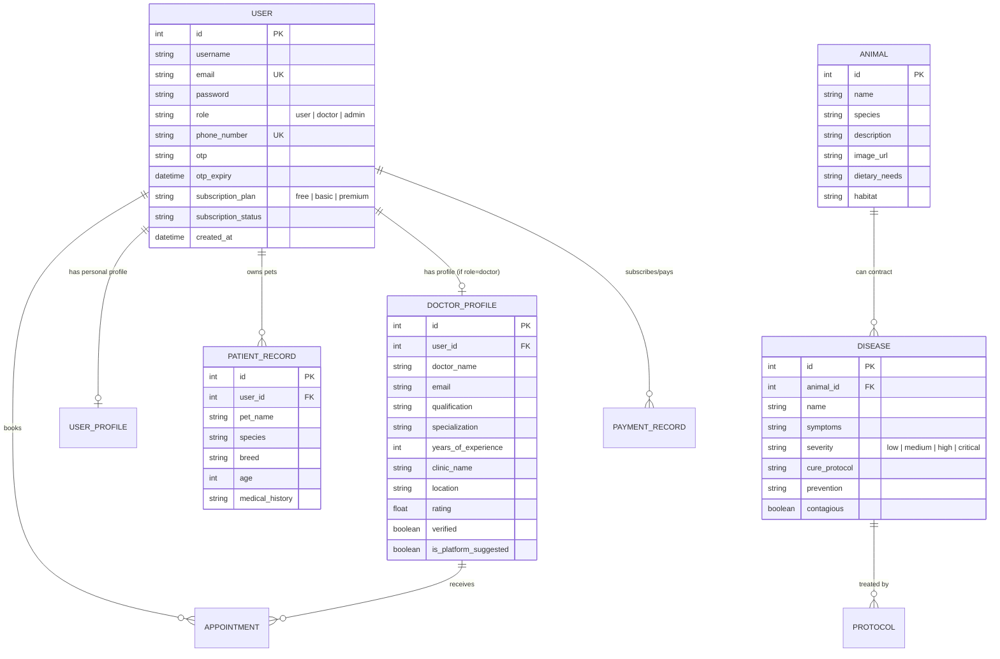

# Low-Level Design (LLD) - Know Your Animal App

## 1. System Overview & Architecture

**Know Your Animal App** is a full-stack platform designed to provide veterinary assistance, pet health tracking, emergency care coordination, and animal disease diagnostics.

### 1.1 Architecture Diagram
```
+-----------------------------------------------------------+
|                    Frontend Layer                         |
|  - React 18 + Vite + TailwindCSS + Radix UI / Shadcn UI   |
|  - State Management: React Hooks, Context API, TanStack   |
+-----------------------------+-----------------------------+
                              | REST APIs / JSON
                              v
+-----------------------------------------------------------+
|                    Backend Service Layer                  |
|  - Python Flask REST API / Node.js Express Endpoints      |
|  - JWT Authentication & RBAC (User, Doctor, Admin)        |
|  - AI Assistant Service (Diagnostic engine)               |
|  - Payment Gateway Adapter (Razorpay)                     |
+-----------------------------+-----------------------------+
                              | ORM / Driver
                              v
+-----------------------------------------------------------+
|                    Persistence Layer                      |
|  - Relational Database: SQLite (Dev) / PostgreSQL (Prod)  |
|  - Tables: Users, Doctors, Animals, Diseases, Treatments  |
+-----------------------------------------------------------+
```

---

## 2. Database Schema & Data Models

### 2.1 Entity Relationship Model


---

## 3. Module & Component Breakdown

### 3.1 Authentication & Authorization Module
- **Mechanism:** JWT (JSON Web Tokens) with HS256 algorithm.
- **Roles:**
  - `user`: Standard pet owners and caretakers.
  - `doctor`: Verified veterinary professionals with custom portal access.
  - `admin`: Platform administrative oversight and catalog management.
- **OTP Verification:** Short-lived 6-digit numeric token with 10-minute expiry window.

### 3.2 Veterinary & Disease Diagnostics Engine
- **Animal Catalog:** Curated database of 17+ common household, farm, and exotic animal species.
- **Disease & Protocol Mapping:** 60+ indexed medical protocols covering symptoms, transmission vectors, first-aid measures, and pharmaceutical recommendations.
- **AI Triage Assistant:** Natural language query processor matching symptoms to prospective conditions and advising when immediate emergency clinic intervention is required.

### 3.3 Appointment & Doctor Coordination
- **Directory Search:** Geo-location and specialization filter for verified veterinarians.
- **Booking Flow:** Real-time scheduling with status transitions:
  `PENDING` &rarr; `CONFIRMED` &rarr; `COMPLETED` / `CANCELLED`.

### 3.4 Payment & Subscription Gateway
- **Processor:** Razorpay API integration.
- **Security:** HMAC-SHA256 signature verification on payment callbacks.
- **Order Flow:**
  1. Frontend calls `/api/payment/create-order` with target subscription plan.
  2. Backend initializes Razorpay order and returns `order_id` & `currency`.
  3. Frontend opens Razorpay Checkout modal.
  4. Upon success, `/api/payment/verify` validates cryptographic signature before activating membership tier.

---

## 4. API Specification

| Endpoint | Method | Role | Description |
|---|---|---|---|
| `/api/auth/register` | `POST` | Public | Register new user account |
| `/api/auth/login` | `POST` | Public | Authenticate and obtain JWT token |
| `/api/auth/login-doctor` | `POST` | Doctor | Doctor authentication portal |
| `/api/auth/send-otp` | `POST` | Public | Request SMS/Email verification OTP |
| `/api/auth/verify-otp` | `POST` | Public | Validate OTP and activate credentials |
| `/api/animals` | `GET` | Public | Fetch list of supported animal species |
| `/api/animals/:id` | `GET` | Public | Fetch single animal details & known diseases |
| `/api/diseases/search` | `GET` | Public | Search diseases by symptoms and species |
| `/api/doctors` | `GET` | Public | Directory of verified veterinary doctors |
| `/api/doctors/profile` | `PUT` | Doctor | Update practitioner credentials and clinic data |
| `/api/chat` | `POST` | User | Interact with the AI veterinary assistant |
| `/api/payment/create-order` | `POST` | User | Create a Razorpay checkout session |
| `/api/payment/verify` | `POST` | User | Verify payment signature and update tier |
| `/api/admin/overview` | `GET` | Admin | Administrative platform health metrics |

---

## 5. Security & Error Handling Strategies

1. **Password Security:** Salted hashes generated via `werkzeug.security` (PBKDF2-HMAC-SHA256) / `bcrypt`.
2. **CORS Hardening:** Strict origin whitelist restricted to trusted web domains and local dev ports.
3. **Environment Isolation:** Sensitive API tokens (Razorpay keys, JWT secret, database URIs) stored exclusively in `.env` and excluded from version control.
4. **Graceful Fallbacks:** Development mode gracefully falls back to local SQLite when external database environment variables are omitted.
